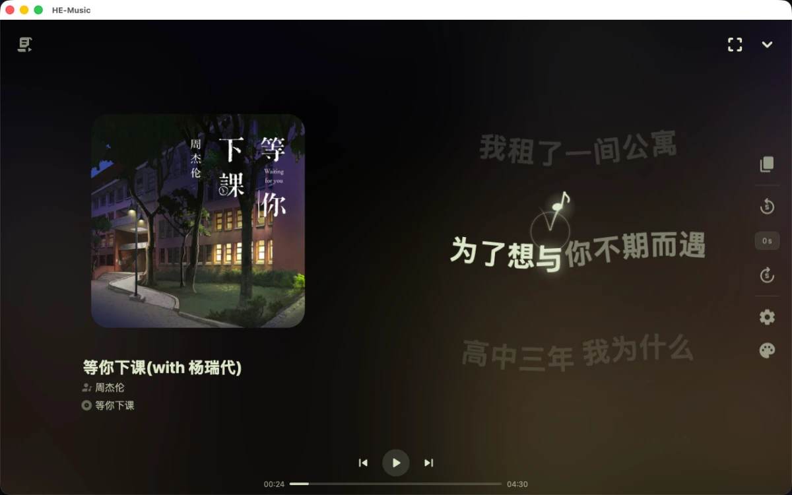
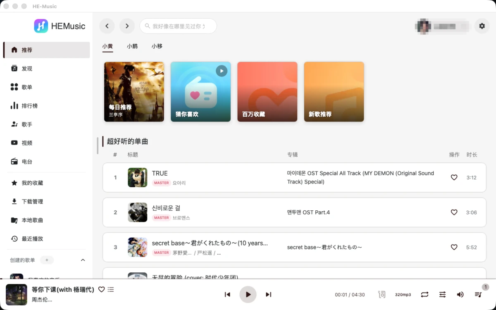

# HE-Music

[](https://awesomemygo.dev/apps/he-music)

HE-Music 是一个支持在线音乐与本地播放的跨平台音乐播放器，提供网页端和 macOS、Windows、Linux 桌面端。

项目源自 [SPlayer](https://github.com/SPlayer-Dev/SPlayer)，现独立维护。SPlayer 已归档，HE-Music 保留原始项目的版权与许可信息，在此基础上持续开发。桌面端自 2.0 起使用 Go + [mygo](https://github.com/egoist/mygo)，通过系统 WebView 运行 Vue 界面。

[下载客户端](https://github.com/he-music/HE-Music/releases/latest) · [更新记录](CHANGELOG.md) · [问题反馈](https://github.com/he-music/HE-Music/issues) · [Android / iOS 版本（Flutter）](https://github.com/he-music/HE-Music-Flutter)

> [!IMPORTANT]
> **在线功能需登录并连接配套后端服务。** 本仓库包含 Web 界面与桌面端原生服务，不包含配套在线服务端，与 SPlayer 的接口不兼容。
>
> 桌面端也支持本地播放器模式，用于管理和播放本地音乐。当前服务的新用户注册要求为 **LinuxDo 等级 ≥ 3**；可用登录方式和音乐平台由配套后端提供。

## 界面预览

播放与歌词界面：



<details>
<summary>查看推荐首页</summary>



</details>

## 主要功能

- **在线音乐**：推荐首页、发现页、搜索、歌单与收藏、评论、MV 和视频播放，具体内容取决于配套后端和可用音乐平台。
- **歌词展示**：逐字歌词、翻译与音译；支持普通、AMLL、莫奈、云阶、流光和跃音等歌词效果，以及半屏歌词布局和纯歌词模式。
- **个性化外观**：封面主题色自适应、浅色／深色／跟随系统主题、多语言界面。
- **桌面集成**：桌面歌词、托盘、全局快捷键与系统媒体控制。
- **本地音乐与下载**：本地曲库与本地歌单管理、标签及封面编辑、歌曲下载与下载任务管理；支持同音质已下载文件优先播放。
- **播放引擎**：默认使用 Web Audio；桌面端可切换到 mpv，运行库随安装包提供，无需另行安装。mpv 支持 APE、DSF、DFF（含 DST 压缩）等格式。
- **数据与更新**：桌面端支持应用数据备份与恢复、旧 Electron 版数据导入，以及带签名校验的应用内更新。

桌面原生功能由 mygo 提供，网页端受浏览器能力限制。移动浏览器仅做基础适配；Android 和 iOS 应用请参见独立的 [HE-Music-Flutter](https://github.com/he-music/HE-Music-Flutter) 项目。

## 客户端安装

从 [GitHub Releases](https://github.com/he-music/HE-Music/releases/latest) 下载最新正式版。运行客户端无需安装 Node.js、Go 或 mpv。

### 下载安装包

| 系统            | 安装方式                                                                                                   |
| --------------- | ---------------------------------------------------------------------------------------------------------- |
| macOS           | 下载 universal `.dmg`，将应用复制到 `~/Applications` 等用户可写目录后运行；同时支持 Apple Silicon 和 Intel |
| Windows         | 下载对应架构的 `*-setup-*.exe`，按当前用户安装；x64 对应 `amd64`，ARM64 对应 `arm64`                       |
| Ubuntu / Debian | 使用 `.deb` 安装和升级；需要应用内自动更新时，改用下方脚本安装到用户目录                                   |
| 其他 Linux      | 下载对应架构的 `.tar.gz` 和同一 Release 的 `install.sh`，将本地 `.tar.gz` 路径作为脚本参数执行             |

运行环境与安装注意事项：

- **macOS**：从复制后的应用目录启动，不直接从 DMG 中运行。当前安装包使用 ad hoc 签名，尚未完成 Apple 公证；首次打开可能需要在系统「隐私与安全性」中允许运行。
- **Windows**：需要已安装 WebView2 Runtime。
- **Linux**：需要 GTK3／WebKitGTK，以及 GStreamer base、good、bad、libav 和 pulseaudio 插件。图形兼容模式与桌面歌词说明见[桌面指南](desktop/README.md)；Wayland 歌词交互仍待实机验收。

### 脚本安装

脚本从正式频道安装最新版本，自动选择架构并按当前用户安装，无需使用 `sudo` 或管理员终端。

macOS / Linux：

```sh
curl -fsSL https://github.com/he-music/HE-Music/releases/latest/download/install.sh | sh
```

Windows PowerShell：

```powershell
irm https://github.com/he-music/HE-Music/releases/latest/download/install.ps1 | iex
```

Linux 默认安装到 `~/.local/he-music.app`。通过 `.deb` 安装的版本应使用包管理器或新版 `.deb` 升级。

### 更新与旧版迁移

已安装 mygo 正式版的用户，可在「设置 → 关于 → 检查更新」中升级；安装完成后重启应用生效。

从旧 Electron 版迁移需要手动安装，并按[应用数据与 Electron 导入](docs/mygo-data.md)导出、导入数据。音乐文件不包含在业务数据备份中，本地音乐目录需重新选择。`HE-Music Update Test` 是独立的更新演练应用，日常使用请安装正式版。

## 源码开发与构建

界面使用 Vue 3、TypeScript、Pinia、Naive UI 和 Vite；桌面原生服务使用 Go + mygo。

### 环境准备

- **Web 开发**：Node.js 24 LTS（最低 24.12.0，见 [.nvmrc](.nvmrc)）和 pnpm 10.28.1（见 [package.json](package.json)）。使用 nvm 时可运行 `nvm install`、`nvm use`。
- **桌面开发**：在上述环境基础上安装 Go 1.27.3（见 [go.mod](go.mod)）、Python 3.10+ 及目标平台所需的 mygo 构建依赖。Python 用于准备随包 libmpv，详见[播放引擎资源说明](scripts/mpv/README.md)。

```sh
git clone https://github.com/he-music/HE-Music.git
cd HE-Music
npm install -g pnpm@10.28.1
pnpm install --frozen-lockfile
cp .env.example .env
```

编辑 `.env`，将 `VITE_API_URL` 配置为实际可用的 HE-Music 配套后端地址。默认示例地址无法提供在线服务；仅启动或打包界面不会获得后端能力。

本地标签编辑器的「自动匹配标签」使用 HE-Music 后端提供的音乐平台搜索；选择平台及候选歌曲后回填标签，点击保存才写入文件。

### 启动开发环境

网页端：

```sh
pnpm dev:web
```

默认访问 `http://127.0.0.1:14666`，端口可通过 `.env` 中的 `VITE_WEB_PORT` 修改。

桌面端：

```sh
pnpm vendor:check
pnpm dev
```

`pnpm dev` 默认启动 mygo 桌面开发。Go SDK 与官方 CLI 固定在仓库 `vendor/` 中，开发入口会核对锁定依赖，并准备所需的 libmpv 资源；首次准备需要下载资源。修改原生服务后执行 `pnpm generate:desktop` 重新生成绑定。依赖升级和补丁维护见[固定 SDK 说明](patches/mygo/README.md)。

### 构建

| 命令               | 目标                 | 输出目录                    |
| ------------------ | -------------------- | --------------------------- |
| `pnpm build:web`   | Web 静态文件         | `dist/web/`                 |
| `pnpm build:mac`   | macOS arm64 本地构建 | `build/mygo/darwin-arm64/`  |
| `pnpm build:win`   | Windows amd64        | `build/mygo/windows-amd64/` |
| `pnpm build:linux` | Linux amd64          | `build/mygo/linux-amd64/`   |

Web 静态文件部署时需配置单页应用路由回退，并保证浏览器能访问配套后端。桌面构建取决于目标平台的工具链；正式发行的 macOS universal、Windows／Linux ARM64 产物由发布工作流构建。

### 常用检查

```sh
pnpm typecheck
pnpm lint:check
pnpm test
pnpm vendor:check
```

Go 静态检查使用 `pnpm lint:go`，需安装 mise，由其运行固定版本的 golangci-lint。协作约定和按修改范围选择检查的说明见 [AGENTS.md](AGENTS.md)。

分支推送和 Pull Request 会自动执行前端／Go 静态检查、类型检查、前端／Go 测试、固定依赖校验及 Web 构建；发布工作流复用同一组检查。Fork 未配置后端地址时使用占位地址完成离线验证，构建产物不具备在线服务能力。

## 开发与维护文档

- [更新记录](CHANGELOG.md)：版本变更和升级说明。
- [核心链路验收](docs/core-acceptance.md)：关键场景、自动测试入口及实际平台交互的证据边界。
- [桌面指南](desktop/README.md)：mygo 原生能力、平台差异和诊断入口。
- [应用数据与 Electron 导入](docs/mygo-data.md)：备份、恢复与旧版迁移。
- [本地曲库与已下载播放](docs/local-library.md)：本地歌单、已下载优先播放、自动同步和验证边界。
- [GitHub 发布与 mygo 自动更新](docs/mygo-updates.md)：发布准备、签名、更新演练和故障排查。正式 `v*` tag 在工作流校验通过后直接公开 Release 并设为 latest；测试 `mygo-test-v*` tag 生成草稿，手动运行工作流仅生成测试产物。
- [固定 SDK 与补丁维护](patches/mygo/README.md)：Go 依赖锁定及 Windows 窗口补丁。
- [随包 libmpv 资源](scripts/mpv/README.md)：播放引擎资源准备、校验和第三方许可。
- [产品上下文](CONTEXT.md)：页面、内容模型与歌词展示术语。

## 版权与许可

本项目源自 [SPlayer](https://github.com/SPlayer-Dev/SPlayer)，保留原始项目的版权与许可证声明：

```copyright
原始项目：SPlayer
版权所有 © 2022-present Imsyy
许可证：AGPL-3.0
源码仓库：https://github.com/SPlayer-Dev/SPlayer
```

本项目采用 [GNU Affero General Public License v3.0](LICENSE)。修改、分发或通过网络向用户提供修改后的程序时，请遵守许可证中适用的源代码提供义务，并保留原作者版权、许可证和第三方声明。完整条款以 [LICENSE](LICENSE) 为准。

使用声明：

> - 本项目仅供个人学习研究使用，禁止用于商业及非法用途。
> - 禁止用于售卖或其他盈利用途，如若发现，作者保留追究法律责任的权利。
> - 禁止在二开项目中修改程序原版权信息（您可以添加二开作者信息）。

## 鸣谢

感谢以下项目提供的基础、支持与灵感：

- [SPlayer](https://github.com/SPlayer-Dev/SPlayer)
- [mygo](https://github.com/egoist/mygo)
- [NeteaseCloudMusicApi](https://github.com/Binaryify/NeteaseCloudMusicApi)
- [YesPlayMusic](https://github.com/qier222/YesPlayMusic)
- [UnblockNeteaseMusic](https://github.com/UnblockNeteaseMusic/server)
- [applemusic-like-lyrics](https://github.com/Steve-xmh/applemusic-like-lyrics)
- [Vue-mmPlayer](https://github.com/maomao1996/Vue-mmPlayer)
- [refined-now-playing-netease](https://github.com/solstice23/refined-now-playing-netease)
- [material-color-utilities](https://github.com/material-foundation/material-color-utilities)
- [Folia](https://github.com/chthollyphile/folia-major)

## 免责声明

本项目基于 SPlayer 进行二次开发，产生的责任与 SPlayer 及其开发者无关。

歌曲、图片及歌词来源于网络，仅供学习、交流使用，不具有任何商业用途。如因使用本项目引起纠纷或责任，由使用者自行承担。本项目开发者不承担因使用本项目导致的直接或间接责任，并保留追究使用者违法行为的权利。

请遵守相关法律法规，不要将本项目用于商业及非法用途。使用者应自行承担使用风险；本项目不对所提供的服务和内容作任何保证。

## 友情链接

- [LINUX DO](https://linux.do/)：真诚、友善、团结、专业，共建你我引以为荣之社区。

## Star History

[](https://api.star-history.com/svg?repos=he-music/HE-Music&type=Date)
